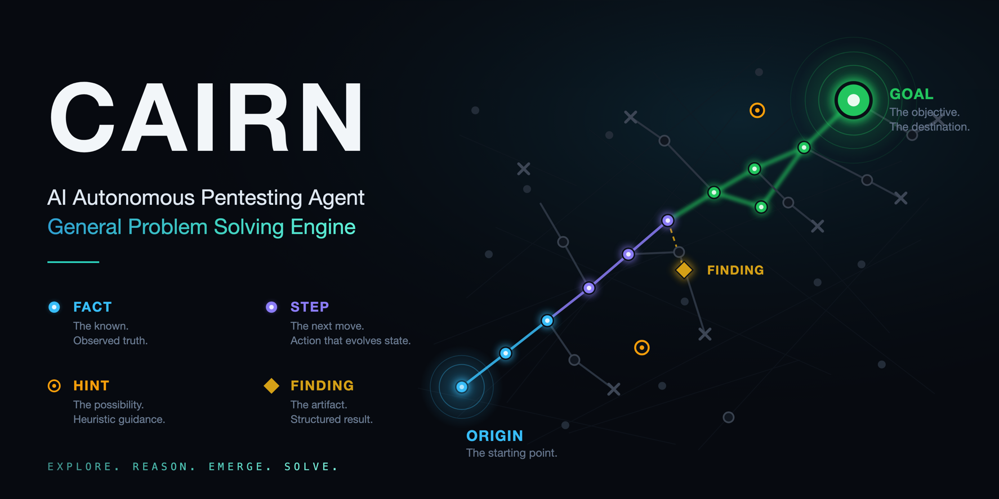

<div align="center">



# Cairn_X

### FGS 图驱动的通用问题求解引擎

<p>
  <a href="https://zc.tencent.com/hackathon" target="_blank" rel="noopener noreferrer">
    
  </a>
  <a href="https://zc.tencent.com/hackathon" target="_blank" rel="noopener noreferrer">
    
  </a>
</p>

Cairn_X 无角色、无工作流：给定起点与目标，在未知状态空间中搜索路径。

</div>

## 架构

Cairn_X 把任务建模为**面向目标的状态空间搜索**，将事实、目标、步骤及其关联外化为持久化的 **FGS 图**（Fact-Goal-Step Graph）：

| 概念        | 含义                                                                  |
| ----------- | --------------------------------------------------------------------- |
| **Fact**    | 已确认的客观事实，即当前的世界状态                                    |
| **Goal**    | 完成条件（搜索终止条件）；支持动态增删的 **Sub Goal** 做阶段性推进    |
| **Step**    | 下一步行动，推动世界状态演化的因果过程；有优先级，可废弃              |
| **Finding** | 搜索过程的结构化产物（如漏洞），与最终 Goal 分离，schema 可按项目定义 |
| **Hint**    | 人类随时注入的判断，由 Decide 下次运行吸收                            |

系统只有两类活动，本质是同一个运行器注入不同的提示词与工具：

- **Decide**（串行）：只拥有操作 FGS 图的工具——增删/废弃/调优先级 Step、增删 Sub Goal、判定目标达成。每次触发都是干净上下文。
- **Execute**：拥有改变世界状态的工具（`read/bash/edit/write`）与写图工具——`submit_fact`（探索中确认的事实**实时**写入图，不攒到结束）、`submit_finding`（固化成果）、`submit_result`（提交结构化交付）。

Agent Loop 基于进程内 PI 库（[pi](https://github.com/earendil-works/pi)，npm `@earendil-works/pi-*`）运行，不依赖任何外部 CLI；模型端点只要 OpenAI/Anthropic 兼容即可，Decide 与 Execute 可用不同模型。

```
          ┌───────────────────────────────────────┐
          │  FGS Server + Executor 控制面 (cairn-x) │
          │  Facts + Goals + Steps + 事实/发现/轨迹 │
          │  执行协议 · 短期执行令牌 · 受限模型代理   │
          └───────┬───────────────────────┬───────┘
                  │ Read/Write API        │ /internal/activities/model (流式透传+凭据注入)
          ┌───────┴────────┐      ┌───────┴─────────────────┐
          │ Dispatcher     │      │ Executor Worker 容器     │
          │ Step 选择/并发  │      │ (每个活跃项目一个常驻)     │
          │ 租约/取消/重试   │─────▶│ Worker 程序 = 容器入口    │
          │ Worker 容器启动 │ docker│ 完整 Agent Loop + 本地    │
          │ 与回收         │  run │ bash/read/edit/write     │
          └────────────────┘      └─────────────────────────┘
```

Dispatcher 只做调度决策（认领 Step、分配执行尝试、超时与取消）。每个活跃项目拥有一个常驻 Worker 容器（`cairn-pw-<projectId>`）：容器入口就是 Worker 程序，它在容器内完成完整 Agent Loop——经控制面的受限模型代理调用模型（长期 key 只留在控制端），在 `/workspace` 里直接执行本地工具，把事实与发现实时提交回图谱。执行走显式协议（任务领取、心跳租约、事件/轨迹流、幂等提交、结果持久化确认、取消传播）；Worker 只持有绑定单次执行的短期令牌，没有 docker 权限、数据库凭据和模型 API key。上传文件通过 `dataRoot/uploads/<projectId>` 以 `/workspace/uploads` 只读挂载。

图谱保留探索记录，但不是严格的只追加事件库：步骤、目标和路线的状态会更新。图谱接口返回当前状态投影，轨迹用于追溯执行过程；前端历史回放仅作近似展示。

Agent 工具的提交、信号回执与收尾权限约束，见 [工具契约说明](docs/agent-tool-contracts.md)。

## Getting Started

**Prerequisites**：macOS 或 Linux、Node ≥ 22.19、Docker（Worker 容器执行需要）。

```bash
cd cairn-x
npm install
npm run build:web # 构建 React 工作台，由 Hono 同源提供

# 构建 Worker 镜像（执行沙箱 + Worker 程序入口）
docker build -f Dockerfile.cairn-x -t cairn-x-worker:latest ..

# 首次启动前准备部署配置（密钥支持 env:VAR_NAME，不写入日志）
cp dispatch.example.yaml dispatch.yaml

# 设置两个独立凭据；保存 API token，供另一个终端的 dispatcher 使用
export CAIRN_WEB_PASSWORD="$(openssl rand -hex 32)"
export CAIRN_API_TOKEN="$(openssl rand -hex 32)"

# 首次创建数据库时导入模型与运行参数；已有数据库由工作台设置管理
npm run cli -- serve --config dispatch.yaml --import-config
# 之后正常启动不再读取 YAML 中的模型与运行参数，也不会覆盖库内配置
npm run cli -- serve --config dispatch.yaml

# 另开一个终端，进入 cairn-x/，设置同一个 CAIRN_API_TOKEN
npm run cli -- dispatch --config dispatch.yaml

# 只跑启动健康检查（校验 dispatch.yaml 里的模型端点可达，不读库内模型）
npm run cli -- dispatch --config dispatch.yaml --startup-healthcheck-only
```

`dispatch.example.yaml` 中可配置容器资源限制（CPU/内存/进程数/网络）、TSecBench 评测段、单条 bash 超时（`bash_timeout`）等部署参数。模型与 Agent 配置首次初始化后以数据库中的配置为准：Decide/Execute 各自的模型端点、运行预算（run_seconds / harvest_seconds）与并发上限在工作台「设置」里编辑；执行截止时间始终由服务端按库内预算计算。修改仓库中的提示词文件不会自动覆盖已保存的提示词；更新方法见 [工作台配置说明](cairn-x/src/web/README.md#提示词更新与生效范围)。

### 本地开发模式

```bash
docker build -f Dockerfile.cairn-x -t cairn-x-worker:latest ..
docker network inspect cairn-workers >/dev/null 2>&1 || docker network create cairn-workers
export CAIRN_WEB_PASSWORD="$(openssl rand -hex 32)"
export CAIRN_API_TOKEN="$(openssl rand -hex 32)"

npm run dev -- --config dispatch.yaml --import-config # 首次导入模型与运行参数
npm run dev -- --config dispatch.yaml                 # 之后
```

一个命令启动独立的 Server 和 Dispatcher，Execute 仍在 Docker Worker 中运行。开发数据默认在 `datas/cairn-x-dev`，不会读取或调度生产数据 `datas/cairn-x`。默认 Server 地址 `http://127.0.0.1:18000`；Worker 在 macOS Docker Desktop 和 Linux Docker 上都通过 `host.docker.internal` 回连宿主机（Linux 上启动器自动加入 Docker 的 `host-gateway` 映射）。可用 `--data-root`、`--port`、`--worker-control-url`、`--container-prefix` 覆盖默认值。按 `Ctrl-C` 时先停 Dispatcher 并回收它管理的 Worker，再关闭 Server，数据保留。

### Docker Compose

```bash
cp cairn-x/dispatch.example.yaml cairn-x/dispatch.yaml # 填入模型端点与 key
cp .env.example .env && vi .env                        # 填 CAIRN_WEB_PASSWORD / CAIRN_API_TOKEN
docker compose --profile build build                    # Worker 镜像在 build profile 中，必须显式构建
docker compose up
```

Compose 启动 serve + dispatcher 两个控制端服务（共享 `cairn-workers` 网络），Worker 经 `http://cairn-x-server:8000` 回连控制面。Server 只挂载数据目录、不安装 Docker CLI；只有 Dispatcher 挂载 `/var/run/docker.sock`。单独的 `docker compose up --build` 不会构建 Worker 镜像。

### 服务器部署（Linux + Docker Compose）

与本地 Compose 相同，另有三处服务器特有配置：

1. **凭据**：`.env` 中 `CAIRN_WEB_PASSWORD` 与 `CAIRN_API_TOKEN` 必填（分别 `openssl rand -hex 32` 生成独立随机值），compose 不提供默认值，为空直接报错；`CAIRN_DATA_HOST_ROOT` 指定宿主机绝对数据目录；模型 key 用 `DECIDE_API_KEY` / `EXECUTE_API_KEY`，在 `dispatch.yaml` 里以 `env:XXX` 引用。裸机 CLI 不自动读取 `.env`，需自行导出。
2. **dispatch.yaml**：把 `server` 从 `http://127.0.0.1:8000` 改为 `http://cairn-x-server:8000`（compose 网络内的服务别名）；`127.0.0.1` 只保留给本地裸机开发。
3. **启动**：`docker compose --profile build build && docker compose up -d`，`curl http://localhost:8000/` 探活（首次启动自动建库）。

模型配置（`dispatch.yaml` 的 `models` 段）只在数据库首次初始化时导入一次，之后以工作台「设置」页为准。

**公网加固**：compose 将 8000 绑到 `0.0.0.0`，生产环境不要直接暴露。用 Nginx/Caddy 反代并开启 HTTPS（需透传 `Upgrade` 头以支持流式接口），防火墙仅放行 443。备份即拷贝 `CAIRN_DATA_HOST_ROOT`（SQLite、轨迹和 uploads）。更新代码后 `docker compose --profile build build && docker compose up -d`。Worker 容器默认限额 2 CPU / 2G 内存、最多 3 个项目并发，建议宿主机 ≥ 4 核 8G。

### PI 插件

Decide 和 Execute 各自维护独立的 PI 插件集合。插件安装由 Dispatcher 完成，Server 只保存操作队列；插件包不会进入项目 Worker 的可写目录。安装成功生成不可变版本，新建活动才使用新版本；卸载在正在使用的活动结束后删除文件。

```bash
npm run cli -- plugins list --role execute
npm run cli -- plugins install --role execute npm:@scope/package@1.0.0
npm run cli -- plugins install --role decide git:github.com/org/repo@v1
npm run cli -- plugins remove --role execute npm:@scope/package@1.0.0
```

支持 PI 原生的 npm、Git 和本地目录来源。相对本地路径以部署端的 `<dataRoot>/plugin-sources/<role>/` 为基准，Docker Compose 中对应 `/data/plugin-sources/<role>/`。Execute 插件安装产物以只读方式挂载到 Worker，Decide 插件在 Dispatcher 进程中加载。需要终端交互 UI 的插件不会在 Cairn_X 活动中工作。网页「插件」页提供同等功能。

### TSecBench 评测接入

Cairn_X 可接入腾讯 [TSecBench](https://tsecbench.zc.tencent.com) 智能攻防评测平台：自动拉题、启动靶场、一题一个项目、通关后提交 flag 并释放容器。平台 token 只留在 serve 进程，Worker 经执行协议代理 `benchmark_submit_flag` / `benchmark_hint`，容器里拿不到 `BENCHMARK_TOKEN`。

设 `BENCHMARK_TOKEN`（平台建跑分任务后下发）与可选的 `BENCHMARK_BASE_URL`（默认 `https://tsecbench.zc.tencent.com`）即可启用；也可写进 `dispatch.yaml` 的 `benchmark` 段（`token: "env:BENCHMARK_TOKEN"` 或直接写 uuid，`max_active` 默认受平台硬上限 3 约束，`auto_start` / `auto_close` 控制启停）。解析 token 失败只打印警告并关闭评测集成，不影响 serve/dispatch。

题目入口只在靶场 VPN 内可达，VPN 配置随跑分任务下发（`task_*_vpn_config.ovpn`）。推荐宿主装 VPN 并把容器子网路由进隧道，以保留容器网络隔离：

```bash
sudo openvpn --config task_xxx_vpn_config.ovpn --daemon --log /var/log/tsecbench-vpn.log
sudo sysctl -w net.ipv4.ip_forward=1
SUBNET=$(docker network inspect cairn-workers -f '{{range .IPAM.Config}}{{.Subnet}}{{end}}')
sudo iptables -I FORWARD -s "$SUBNET" -o tun0 -j ACCEPT
sudo iptables -I FORWARD -d "$SUBNET" -i tun0 -m state --state RELATED,ESTABLISHED -j ACCEPT
sudo iptables -t nat -A POSTROUTING -s "$SUBNET" -o tun0 -j MASQUERADE
# 验证：docker run --rm --network cairn-workers alpine sh -c 'nc -vz -w3 <ip> <port>'
```

若 .ovpn 带 `redirect-gateway def1` 会劫持宿主默认路由、可能切断 serve 访问模型端点，加 `pull-filter ignore "redirect-gateway"` 再重启。也可让 Worker 直接用宿主网络（`container.network: "host"` + `worker_control_url: "http://127.0.0.1:8000"`），配置最少但失去网络隔离，仅适合评测专用机。

运行：`npm run cli -- benchmark --config dispatch.yaml --doctor` 体检，`--list` 看题目与进度，`--once` 跑一轮，`--interval 30` 常驻编排，`--challenge <code>` 只处理指定题目。评测要跑数小时，推荐用内置的受监管 driver 服务：`docker compose --profile eval up -d cairn-x-benchmark`（进度存在 serve 的 `benchmark_tasks` 表，重启不丢）。绑定过的 `unique_code` 不会自动重绑，要重跑显式加 `--rebind`。

## 开发与测试

```bash
cd cairn-x
npm test               # 完整 Vitest（先构建工作台）；Docker E2E 需要本地 daemon
npm run check          # 类型 → lint → 格式 → 依赖边界 → 死代码 → 核心回归，失败即停止
npm run typecheck      # tsc（后端 + 前端）
npm run lint           # oxlint correctness 规则
npm run check:deps     # 源码运行时循环依赖 + 模块边界
npm run knip           # 未引用的文件 / 依赖 / 导出（死代码）
npm run test:core-deps # 固定的核心依赖回归集合，不触发前端构建
```

`test:core-deps` 不访问真实模型或启动 Docker，文件清单在 `cairn-x/vitest.core.config.ts`；首次运行前如缺少 `cairn-x/dist-web/`，先执行一次 `npm run build:web`。模块边界和检查器说明见 [核心依赖规则](docs/core-dependencies.md)。

前端工作台的开发、构建、验证和新增只读轨迹接口，见 [Web 文档](cairn-x/src/web/README.md)。

## License

本项目以 **MIT** 授权。

## 参考

https://github.com/oritera/Cairn
